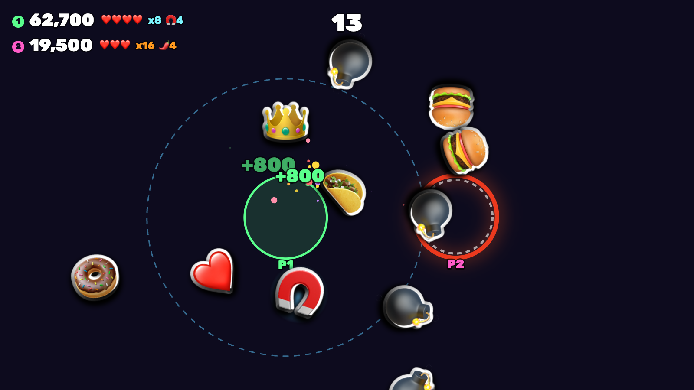
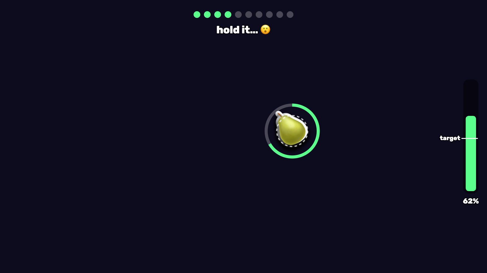

# Chomper

A browser game you play with your mouth. Literally.

Your webcam tracks where your mouth is and how wide it's open. Food gets tossed across the screen, you lean over to line up with it, and you open wide to eat it. There are bombs mixed in too, so you can't just leave your mouth hanging open the whole round (people try).

I built it solo at HackNC 2026.



<sub>Rendered without the camera, so the background is empty. In the real game your webcam feed is behind all of this.</sub>

## How to play

Move your head to aim. Open your mouth to chomp.

| Item | What it does |
| --- | --- |
| 🍕 🍩 🍣 and friends | Points. Eat them back to back to build a combo multiplier. |
| 💣 | Lose a life. |
| ⭐ | Big points and a moment of slow motion. |
| 🌶️ | Double points for 6 seconds. |
| 🧲 | Pulls nearby food into your mouth for 6 seconds. |
| ❤️ | Get a life back. |

Rounds last 60 seconds. The last 8 seconds are a feast: no bombs, just food everywhere.

**Up to 4 people can play at once** on one laptop. Everyone squeezes into the frame, players get numbered left to right, and whoever's winning gets a crown drawn on their head. At the end you get a photo of each player's widest chomp, which is honestly the best part.

You never have to touch the keyboard. To pick a mode, aim your mouth at one of the bubbles on the title screen and open wide.

## Jaw Workout mode

Chomper also has a second mode that isn't really a game.

Jaw-opening exercises are a normal part of recovery for things like TMJ problems, stiffness after head and neck radiation, and facial weakness after a stroke. The problem is that they're boring and you're supposed to do them every day, so people stop.

Jaw Workout turns each rep into something to aim at. A snack shows up on screen, you line your mouth up with it, open past your target, and hold until the ring fills. The target adjusts to your own range as you go. After 10 reps you see how wide you opened on average, how that compares to last time, a chart of your recent sessions, and your daily streak.

To be clear, I'm not a clinician and this isn't a medical device. The "opening %" is the face model's own estimate, not a measurement in millimeters. It's a prototype of what at-home practice could feel like if it were fun.



## Running it

You need Node 18 or newer and a webcam.

```bash
npm install
npm run dev
```

Then open the URL it prints (usually http://localhost:5173) in Chrome and allow camera access.

No camera? Press **F** to play with the mouse instead (hold click to open your mouth).

| Key | Does |
| --- | --- |
| Enter | Start a game |
| W | Start a Jaw Workout |
| F | Switch between face and mouse controls |
| M | Mute |
| Esc | Back to the title screen |

## How it works

Face tracking runs entirely in your browser using Google's [MediaPipe Face Landmarker](https://ai.google.dev/edge/mediapipe/solutions/vision/face_landmarker). For each face it finds 478 points plus a set of expression scores. Chomper only uses a few of them: the lips (where your mouth is), the forehead and chin (how big your face is, and where to put the crown), and the `jawOpen` score (how open your mouth is).

A few details that made it feel right:

- **Open and closed use different thresholds.** Your mouth counts as open above 0.35 but doesn't count as closed again until it drops below 0.22. With a single cutoff, a half-open mouth flickers between the two every frame.
- **Faces get matched frame to frame.** MediaPipe returns faces in a random order each frame, so for multiplayer every new face gets matched to whichever known face is closest. Nobody moves very far in 1/30th of a second, so that keeps Player 1 as Player 1.
- **Food is drawn like stickers.** Every emoji gets a white outline and a drop shadow. Without that, it disappears against a messy background.

Everything stays on your computer. The video never leaves the browser. Scores, photos and workout history live in your browser's local storage. The face model is bundled with the project, so it works without internet once it's installed.

## Code layout

```
src/
  main.ts      screens, menus, main loop, leaderboard
  game.ts      the arcade game: spawning, eating, power-ups, scoring, drawing
  workout.ts   Jaw Workout mode
  face.ts      runs MediaPipe on each camera frame
  tracks.ts    keeps track of which face is which player
  sticker.ts   turns emoji into outlined sprites
  audio.ts     sound effects, synthesized live (no audio files)
```

Built with TypeScript, Vite and the Canvas API. No game engine.

## Credits

- Face tracking: [MediaPipe](https://github.com/google-ai-edge/mediapipe) by Google, Apache 2.0. The model and wasm files in `public/mediapipe` come from there.
- Font: [Rubik](https://fonts.google.com/specimen/Rubik).
- Emoji are your operating system's.

## License

MIT. See [LICENSE](LICENSE).
